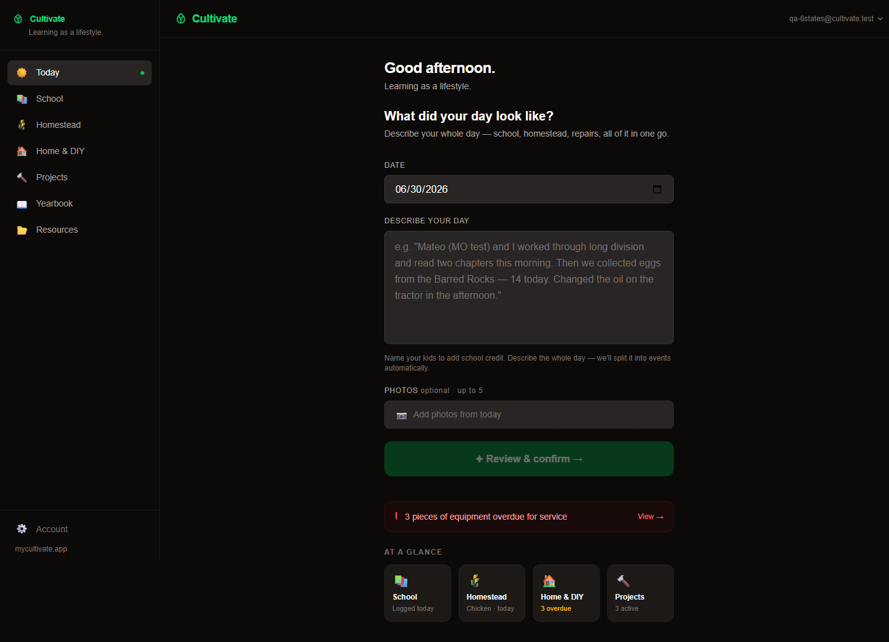
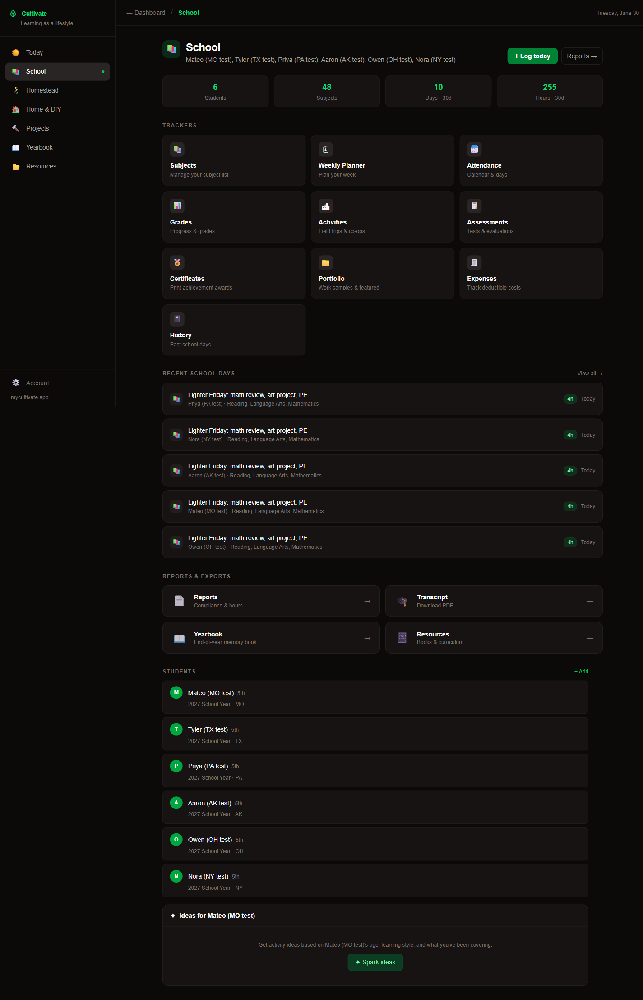
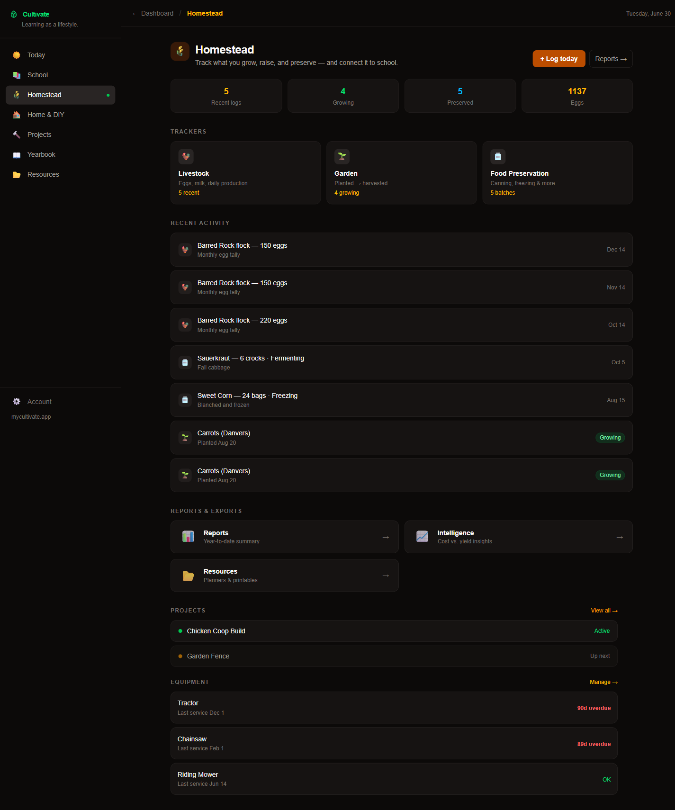
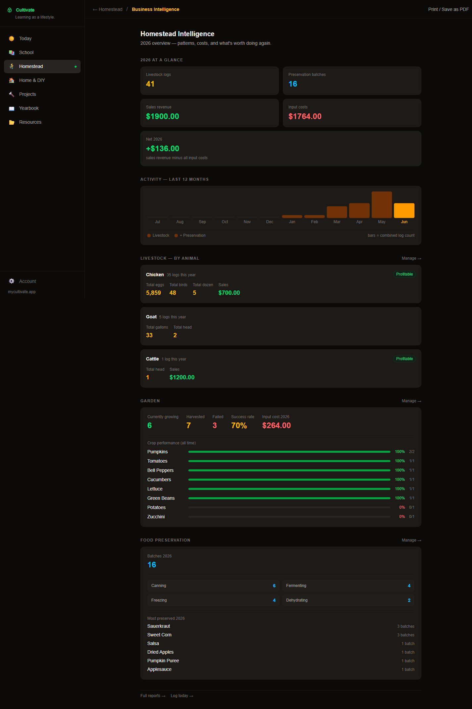

# Cultivate

**A homeschool and homestead record-keeping app for families.** Launched July 2026, closed November 2026.
This repository is a portfolio copy of the application code.

Built by **Kyle O'Guin**, using AI-assisted development (Claude Code) as a pair programmer.



## What it did

Homeschooling families who also run a homestead keep records in a dozen places. Cultivate put them in one.

- **One box for the whole day.** A parent describes the day in plain English ("we did long division, collected 14 eggs, changed the tractor oil"). The app uses Claude to split it into separate school, homestead and repair entries, credits school time to each child, and asks the parent to confirm before saving.
- **School records.** Subjects, a weekly planner, attendance and hours, grades, assessments, a portfolio of work samples, expenses, and certificates.
- **Reports and transcripts.** Hours and attendance reports, plus printable transcripts. Includes 51 state homeschool checklists (50 states plus DC) as reference.
- **Homestead and home.** Livestock, garden beds, equipment with service reminders, and home and DIY projects.
- **Yearbook.** An end-of-year memory book assembled from the year's entries and photos.
- **Reminders.** Web push notifications on the phone, with email as a fallback.
- **Subscriptions.** Individual and family plans through Stripe.

| School | Homestead | Homestead intelligence |
|---|---|---|
|  |  |  |

*All screenshots use test accounts and made-up students.*

## How it was built

- **Next.js** (App Router, React 19, TypeScript) and **Tailwind CSS**, deployed on **Vercel**, with an hourly cron for reminders.
- **Supabase / Postgres.** 38 versioned migrations, and **row-level security** scoped to the household, so every family member sees only their own family's data.
- **Anthropic Claude API** for turning the free-text daily log into structured entries.
- **Stripe** for checkout, subscriptions and webhooks.
- **Sentry** for error monitoring. **Web Push (VAPID)** for notifications.
- **Testing.** Playwright end-to-end tests, pgTAP database tests for the security rules, and CI on GitHub Actions.

## Layout

```
src/app/        pages and API routes (dashboard, school, homestead, reports, stripe, cron, push)
src/lib/        auth, household access, state rules, Stripe, push, helpers
supabase/       migrations and database tests
e2e/            Playwright tests
public/         static assets, state checklists, demo images
```

## Running it

The live service is shut down. To run locally you need your own Supabase project, Stripe keys, an Anthropic API key and VAPID keys in `.env.local`. Then:

```bash
npm install
npm run dev
```

---

© 2026 Kyle O'Guin. Shared for portfolio purposes. All rights reserved.
